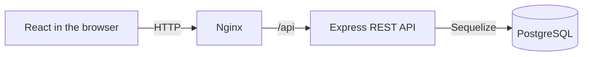

# Notes App

A full-stack application for creating and organizing notes with categories. Built with React, Express and PostgreSQL, with a REST API, relational persistence and a complete Docker Compose environment.

Create, edit, archive and delete notes, assign multiple categories, and combine category and archive-status filters. The interface includes responsive note cards, reusable forms and confirmation dialogs, and success notifications.

**Stack:** React · Vite · Axios · Express · Sequelize · PostgreSQL · Umzug · Docker Compose · Nginx

The UI uses **Category/Categories**. Internal models and API routes use **Tag/Tags**; both refer to the same feature.

## Quick start with Docker

Prerequisites: Git, Bash, and Docker with Compose running in Linux-container mode (verified with Docker 27.4.0 and Compose 2.31.0). On Windows, run the command from Git Bash. No host installation of Node.js, npm or PostgreSQL is required for this path.

Clone the repository, then run the startup script:

```bash
git clone https://github.com/MaxiFabbri/notes-app.git
cd notes-app
```

From the repository root:

```bash
bash run.sh
```

The script checks Docker, creates a root `.env` from `.env.example` with a generated password if it is missing, builds the images, and waits for all services to become healthy. PostgreSQL initializes the database; the backend applies pending migrations before starting. Existing `.env` files and database data are preserved. If an existing `.env` has an empty or incorrect `DB_PASSWORD`, configure it before retrying; the script does not replace it or reset existing database credentials.

Open **http://localhost:3000**, or the address printed by the script when using a different `DOCKER_WEB_PORT`. The first run needs internet access to download images and dependencies. Stop with `docker compose stop`; start again with `bash run.sh`.

The startup order is **PostgreSQL healthy → migrations → backend healthy → frontend healthy**. No manual database creation, dependency installation or migration command is needed for this Docker path.

Default local addresses:

| Component | Address |
| --- | --- |
| Application | http://localhost:3000 |
| API health | http://localhost:3000/api/health |
| Direct backend API | http://localhost:8080/api |
| PostgreSQL for pgAdmin/psql | 127.0.0.1:5433 |

## Features

- Create notes with optional titles and required, non-blank content.
- Edit notes and their category assignments using the same form.
- Delete notes after confirmation.
- Archive/unarchive directly from each card, with separate active and archived views.
- Create categories from the note form, search the available list locally, and select multiple categories.
- Combine category and archive-status filters.
- Manage categories: view usage counts and delete unused categories after confirmation. Archived notes count as usage.
- Prevent duplicate category names regardless of capitalization or surrounding spaces.
- Show loading states, inline errors and success notifications.
- Persist notes, categories and their relationships in PostgreSQL through Sequelize.

Categories are created immediately; assignments are saved with the note form. Cancelling a form after creating a category may leave an unused category, which can be removed through Manage categories.

## Requirements and versions

### Docker execution

Verified with Docker Engine **27.4.0**, Docker Compose **2.31.0**, and Git Bash on Windows. Docker must be running in Linux-container mode. The images provide PostgreSQL 18.0, Node.js 22.13.0 and Nginx (`1.28-alpine`). A Bash startup script supports the Docker workflow on Linux/macOS and Windows with Git Bash; end-to-end execution was verified on Windows with Git Bash.

### Local development without Docker

The following host runtimes are needed only for the manual development path:

| Tool | Version |
| --- | --- |
| Node.js | 22.13.0 |
| npm | 10.9.2 |
| PostgreSQL server and psql | 18.0 |

Install PostgreSQL and start its server before running setup or the backend. You need an administrator role able to create roles and databases for the initial setup, plus `psql` for the setup scripts. Bash is needed for the Linux/macOS script; PowerShell is supported on Windows. Vite requires Node.js 20.19+ on the 20.x line or 22.12+; the verified runtime is 22.13.0.

Main dependency versions recorded in the committed lockfiles:

| Backend | Version | Frontend | Version |
| --- | --- | --- | --- |
| Express | 5.3.0 | React / React DOM | 19.3.1 |
| Sequelize | 6.37.8 | Vite | 8.3.5 |
| pg | 8.23.1 | Axios | 1.21.0 |
| pg-hstore | 2.3.4 | React-Toastify | 11.2.0 |
| Umzug | 3.8.3 | ESLint | 9.39.5 |
| cors | 2.8.6 | @vitejs/plugin-react | 6.1.2 |

Use `npm ci` to install the versions recorded in each lockfile.

## Architecture and implementation



Nginx serves the compiled frontend and proxies API requests to Express. The backend separates HTTP handling, business rules and data access into controllers, services and DAOs. Local development can also run React and Express directly without Docker.

Implementation highlights:

- **Relational modeling:** notes and categories have a many-to-many relationship through an explicit join model, with foreign keys and a composite primary key to prevent duplicate assignments.
- **Database migrations:** versioned schema changes are tracked by Umzug and run automatically before the containerized backend starts.
- **Consistency:** transactions and row locks protect category usage checks before renaming or deletion. A database index enforces case-insensitive category-name uniqueness.
- **Reusable UI:** one form handles note creation and editing; a shared confirmation dialog handles note and category deletion. Category suggestions are filtered locally from a shared list.
- **Reproducible setup:** a Bash launcher prepares local configuration and starts health-checked services, with database files kept in a named volume.

## Project structure

```text
backend/
  migrations/          Versioned PostgreSQL schema changes
  src/
    routes/            REST endpoints
    controllers/       HTTP requests, responses and status codes
    services/          Validation and business rules
    dao/               Sequelize data-access operations
    models/            Note, Tag, NoteTag and their associations
    middleware/        JSON error responses and unknown-route handling
    utils/             Database connection, migrations and startup diagnostics
    server.js          Express entry point
frontend/
  src/
    api/               Axios calls to the REST API
    config/            Shared Axios client
    components/        Cards, forms, category manager and confirmation dialog
    pages/             NotesPage and page-level state
scripts/               PostgreSQL database/role setup for Windows and Bash
run.sh                 Check Docker, prepare local config and start all services
compose.yaml           Container definitions and persistent database volume
.env.example           Configuration template without credentials
```

Backend request flow: **Route → Controller → Service → DAO → Sequelize → PostgreSQL**. The frontend is a separate React SPA.

## Local setup (without Docker)

Run the following steps from the repository root unless a command changes directory. Keep PostgreSQL running throughout.

### 1. Create the database and application role

Linux/macOS, with `psql` available in PATH:

```bash
bash scripts/setup-db.sh
```

Windows PowerShell:

```powershell
.\scripts\setup-db.ps1
```

The PowerShell script searches PATH, then the PostgreSQL 18 default installation directory. For a different installation:

```powershell
.\scripts\setup-db.ps1 -PsqlPath 'C:\path\to\PostgreSQL\bin\psql.exe'
```

For Bash with a different administrator, host or port:

```bash
bash scripts/setup-db.sh -U your_admin_role -h localhost -p 5432
```

The scripts request the PostgreSQL administrator password. If the `notes_user` role is new, they also prompt twice for its password. Remember that application password for the next step.

They create `notes_user` and its database `notes_app` only when missing, and verify ownership and login capability. Repeated runs preserve existing passwords and data. They do not install PostgreSQL, register/start an operating-system service, or create application tables.

### 2. Create the root configuration

Copy the template only if a root `.env` does not already exist:

```bash
cp .env.example .env
```

PowerShell equivalent:

```powershell
Copy-Item .env.example .env
```

Edit `.env` and set `DB_PASSWORD` to the password of **notes_user**, not the PostgreSQL administrator. The template contains no default application password.

| Variable | Default/example | Purpose |
| --- | --- | --- |
| `PORT` | `8080` | Backend HTTP port |
| `FRONTEND_URL` | `http://localhost:5173` | Allowed browser origin for CORS |
| `VITE_API_URL` | `http://localhost:8080/api` | API address used by the browser |
| `DB_HOST` | `localhost` | PostgreSQL host |
| `DB_PORT` | `5432` | PostgreSQL port |
| `DB_NAME` | `notes_app` | Application database |
| `DB_USER` | `notes_user` | Application database role |
| `DB_PASSWORD` | Empty in template | Password chosen during setup |

Quote the password in the local `.env`. Never commit that file. Variables prefixed with `VITE_` are public browser configuration and must not contain secrets. Node loads the root `.env` using `--env-file`; Vite reads it through `envDir`. Restart the corresponding development server after configuration changes.

### 3. Install dependencies

```bash
npm --prefix backend ci
npm --prefix frontend ci
```

### 4. Apply database migrations

```bash
npm --prefix backend run db:migrate
```

This creates `notes`, `tags`, `note_tags` and the migration history table `SequelizeMeta`, then applies the category-name uniqueness index. Umzug records completed migrations; running the command again applies only pending changes. Startup does not apply migrations automatically. Run migrations before the first launch and after pulling changes that add a migration.

### 5. Start the application

Terminal 1:

```bash
cd backend
npm run dev
```

Terminal 2, starting from the repository root:

```bash
cd frontend
npm run dev
```

Open **http://localhost:5173**. The API is available at **http://localhost:8080/api** and the health endpoint at **http://localhost:8080/api/health**. Stop each process with Ctrl+C. This non-Docker development mode uses two terminals. For a single-command Docker startup, use `bash run.sh` as described above.

The backend waits for a successful database connection before listening. The frontend uses port 5173 with `strictPort`, so another process on that port must be stopped or the configuration explicitly updated.

## Docker configuration and operation

The Compose project contains three services:

| Service | Purpose |
| --- | --- |
| `db` | PostgreSQL with a named volume for persistent data |
| `backend` | Express API; applies pending migrations before starting |
| `frontend` | Compiles React in a Node build stage, then serves only the compiled files with Nginx |

The backend runs as the non-root `node` user. Neither application image includes the root `.env` or host `node_modules`. Compose injects backend settings at runtime. The frontend build sets `VITE_API_URL=/api`; Nginx forwards `/api/...` to `backend:8080`, so the browser uses one origin. Local Vite development still uses `VITE_API_URL` from the root `.env`.

Inside Docker, the backend connects to `db:5432`, regardless of the root `.env` host `DB_PORT`. PostgreSQL is published at `127.0.0.1:5433` by default, independently of a Windows/native installation on port 5432. Existing native PostgreSQL data is not copied into Docker. The image initializes the configured database role as its administrator; this Compose setup is intended for local execution.

| Optional variable | Default | Purpose |
| --- | --- | --- |
| `DOCKER_WEB_PORT` | `3000` | Browser port |
| `DOCKER_API_PORT` | `8080` | Direct API port |
| `DOCKER_DB_PORT` | `5433` | PostgreSQL port for host tools |

Stop any other application using these ports before starting, or set alternatives in the root `.env`. With the compiled frontend, no API-URL change is needed when changing Docker ports because it uses the Nginx proxy.

```bash
# Start/rebuild and wait until all services are healthy
bash run.sh

# Inspect service status
docker compose ps

# Follow logs; Ctrl+C exits log-following without stopping containers
docker compose logs -f

# Stop while retaining containers and database data
docker compose stop
```

The named volume preserves database files across restarts and container recreation. `docker compose down` removes containers and the project network but retains the volume. **Do not add `-v` unless you intend to delete the project's database data.**

Database initialization credentials apply only to an empty volume. Changing `.env` later does not change an existing PostgreSQL user's password. The manual `scripts/setup-db.*` scripts are not needed for Docker.

For mixed development, `docker compose up -d db` starts only PostgreSQL. A backend running on the host must then use `DB_HOST=localhost` and `DB_PORT=5433` (or the configured `DOCKER_DB_PORT`), with migrations applied manually. To use a container backend with local Vite, start `docker compose up -d --build backend`, then run `npm --prefix frontend run dev` on the host.

These instructions start the application locally; they do not publish it to an internet hosting service.

## Commands

| Directory | Command | Purpose |
| --- | --- | --- |
| Repository root | `bash run.sh` | Start the complete Docker application |
| `backend` | `npm run dev` | Start API with Node watch mode |
| `backend` | `npm start` | Start API without watch mode |
| `backend` | `npm run db:migrate` | Apply pending schema migrations |
| `frontend` | `npm run dev` | Start Vite development server |
| `frontend` | `npm run lint` | Run ESLint |
| `frontend` | `npm run build` | Generate frontend build in `dist` |
| `frontend` | `npm run preview` | Preview an existing frontend build locally |

Preview uses a separate origin (normally port 4173). To use it against the API, configure `FRONTEND_URL` accordingly and restart the backend. Preview is a local build check, not a production deployment server.

## Data model and rules

- `notes`: UUID, optional title (up to 255 characters), required content, `isArchived`, `createdAt`, `updatedAt`.
- `tags`: UUID, required unique name (up to 255 characters), timestamps.
- `note_tags`: composite primary key (`noteId`, `tagId`) and foreign keys, representing a many-to-many relationship.
- Deleting a note removes its relationships and preserves the categories.
- The API only deletes or renames a category when it has no note relationships. These checks use transactions and row locks. A category becomes editable/deletable again after its last assignment is removed.
- Category-name uniqueness is enforced by a PostgreSQL index on `lower(btrim(name))`.
- Assigning an existing relationship or removing an already-absent relationship is repeatable without duplicating links or deleting either record, provided both records still exist.

The current version has no login or user accounts; notes are shared within this application instance. There are no default login credentials.

## REST API

All routes below are relative to `/api`. JSON request bodies use `Content-Type: application/json`.

| Method | Endpoint | Behavior |
| --- | --- | --- |
| GET | `/health` | Process health response |
| GET | `/notes` | List notes with their categories |
| GET | `/notes?isArchived=false&tagId=<uuid>` | Combine optional status and category filters |
| GET | `/notes/:id` | Read one note |
| POST | `/notes` | Create a note |
| PUT | `/notes/:id` | Update provided note fields, including archive status |
| DELETE | `/notes/:id` | Delete a note |
| GET | `/tags` | List categories with numeric `notesCount`, including archived-note usage |
| GET | `/tags/:id` | Read one category |
| POST | `/tags` | Create a category |
| PUT | `/tags/:id` | Rename an unused category |
| DELETE | `/tags/:id` | Delete an unused category |
| GET | `/notes/:noteId/tags` | List a note's categories |
| POST | `/notes/:noteId/tags/:tagId` | Assign an existing category |
| DELETE | `/notes/:noteId/tags/:tagId` | Remove an assignment |

Example note body:

```json
{
  "title": "Interview preparation",
  "content": "Review REST APIs and PostgreSQL",
  "isArchived": false
}
```

Example category body:

```json
{ "name": "Work" }
```

Create/edit the note first, then use the assignment endpoints for categories. The frontend handles this sequence and retains the saved note ID if a later category request fails, allowing a retry without creating the note again. These separate HTTP requests are not one atomic transaction; partial completion is reported in the form.

Successful creation returns `201`; reads, updates, deletions and assignment operations return `200`. Errors use `{ "error": "message" }`: `400` for invalid data/JSON, `404` for missing records/routes, `409` for duplicate category names or categories in use, `413` for oversized request bodies, and `500` for unexpected failures. Internal API messages retain Tag terminology; the frontend presents it as Category.

## Verification

### Checks completed

- Frontend ESLint and production build.
- API integration checks against real PostgreSQL: create/edit/delete, archive/unarchive, category assignment/removal and combined filters.
- UUID/input validation, malformed JSON, duplicate names/assignments and category usage restrictions (including archived notes).
- Persistence after restarting the backend and after stopping/restarting the database container.
- Clean Git clone in a separate directory, without copying `.env` or `node_modules`: generated configuration, image builds, database initialization, migrations and complete startup.
- Manual browser acceptance checks: create/edit/cancel/delete confirmations, category operations, filters, connection-failure feedback and smaller-screen/text layout.

The clean-clone startup and manual acceptance checks were completed on Windows with Docker Desktop and Git Bash. Linux/macOS end-to-end execution has not been independently verified. No committed automated test suite or `npm test` script is included.

To repeat static checks with the documented Node/npm runtime:

```bash
npm --prefix frontend ci
npm --prefix frontend run lint
npm --prefix frontend run build
```

### Repeat a clean-install check

Use a separate clone of the revision being tested. Do not copy `.env` or `node_modules`. Stop the original Compose application first if it uses the same published ports. From the new clone:

```bash
COMPOSE_PROJECT_NAME=notes-clean-test bash run.sh
```

The separate project name creates isolated containers and a separate database volume, while Docker may reuse cached image layers. Continue to use that project name for subsequent commands:

```bash
COMPOSE_PROJECT_NAME=notes-clean-test docker compose ps
COMPOSE_PROJECT_NAME=notes-clean-test docker compose stop
COMPOSE_PROJECT_NAME=notes-clean-test bash run.sh
```

### Manual acceptance checklist

1. Create a note with a title and another without one. Reject blank or whitespace-only content.
2. Edit content, cancel an edit without saving, and verify the saved data is unchanged.
3. Archive/unarchive a note and check both lists.
4. Create/select categories in a note form and save. Reopen it, remove a category and save.
5. Combine a category filter with each archive status. Notes that no longer match should leave the current view.
6. Cancel note deletion, then confirm deletion on a test note.
7. In Manage categories, used categories (including those on archived notes) cannot be deleted; unused categories require confirmation.
8. Check duplicate category names with different capitalization and surrounding spaces.
9. Stop/restart the application and verify notes and relationships remain.
10. Simulate an unavailable backend: an attempted save should show an error and retain input for retry.
11. Check forms, dialogs and long content at a smaller browser width.

## Troubleshooting

- **Docker unavailable:** start Docker Desktop/the Docker daemon, ensure Linux-container mode and verify `docker info` works.
- **Docker startup failed:** inspect `docker compose ps` and `docker compose logs`. When using a separate test project, set the same `COMPOSE_PROJECT_NAME` on every command.
- **Connection refused:** start PostgreSQL and check `DB_HOST`/`DB_PORT`. On the development Windows machine the service is named `postgresql-x64-18`; service names can differ on other installations.
- **Authentication failed:** check the `notes_user` password in `.env`.
- **Database does not exist:** run the database setup script and check `DB_NAME`.
- **Missing tables:** Docker applies migrations at backend startup; inspect its logs. In manual mode, run `npm --prefix backend run db:migrate`.
- **Frontend cannot load notes:** confirm the backend is running, then check `VITE_API_URL` and that `FRONTEND_URL` exactly matches the browser origin.
- **Port already in use:** stop the other process or update the corresponding port and URL settings.
- **Duplicate category index migration fails:** inspect existing conflicting names before retrying. The migration does not automatically merge or delete existing categories.

## Author

[Maxi Fabbri](https://github.com/MaxiFabbri)
